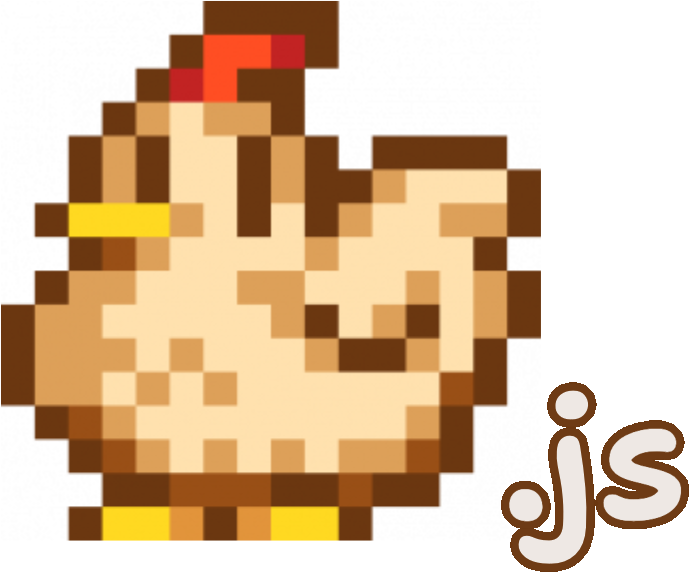

<p align="center">
  <picture>
    <source media="(prefers-color-scheme: dark)" srcset="src/web/wwwroot/chicken-js.png">
    
  </picture>
</p>

<h1 align="center">Stardew.js</h1>

Stardew Valley running in a browser. The game is decompiled, patched to build
against [KNI](https://github.com/kniEngine/kni), and compiled to WebAssembly
with Blazor and WebGL.

## Status

Works:

- the title screen, menus, mouse, keyboard and gamepad
- saves in IndexedDB, plus importing farms from the desktop game's saves folder
- audio through Web Audio, using the game's own XACT mix
- co-op through a relay on the host

## Requirements

- a Steam copy of Stardew Valley (built and tested against the macOS release)
- .NET SDK 10
- [Bun](https://bun.sh) 1.4
- `ilspycmd`: `dotnet tool install -g ilspycmd`
- `ffmpeg`, for the audio

With Homebrew's dotnet, set this before using global tools:

```bash
export DOTNET_ROOT=/opt/homebrew/opt/dotnet/libexec
```

## Build and run locally

Copy your install into `vendor/game/` so that `vendor/game/MacOS/Stardew Valley.dll`
and `vendor/game/Content/` exist. `vendor/` is gitignored.

Decompile and patch the game:

```bash
bun run decompile
```

Extract the audio to Opus:

```bash
bun run extract-audio "vendor/game/Content/XACT/Wave Bank.xwb" --out build/web-content/audio
```

Build and serve:

```bash
bun run web
```

Open http://localhost:5199 and pick your `Stardew Valley.dll` when asked. The tab
must stay visible, because a hidden tab barely runs the game loop.

## Host publicly

Stage a Release build, then build the image:

```bash
dotnet build -c Release src/web/StardewValley.Web.csproj
bun run stage
docker build -t stardew-web build/deploy
```

`build/deploy` and the image contain the game's files. Push them only to a
private registry.

Run the image behind a TLS proxy and set:

| Variable | Value |
|---|---|
| `OWNERSHIP_KEY` | `openssl rand -hex 32`. Without it, every player has to verify again after each redeploy. |
| `SECURE_COOKIES` | `1` if the proxy serves only HTTPS |
| `TRUST_PROXY` | `1` by default. Use `proto` if the proxy sets the scheme but not the client address. |
| `PORT` | `8080` by default |
| `OWNERSHIP_RATE`, `RELAY_RATE` | per-minute limits, to change the defaults |

## Tests

```bash
bun test
```

The tests need no game files.

## Legal

Stardew Valley is © ConcernedApe. This project is unofficial and not endorsed by
ConcernedApe. The decompiled source, the game's content and all build output
are gitignored and must not be redistributed. The repository contains only
original patch scripts, shims and tooling.
